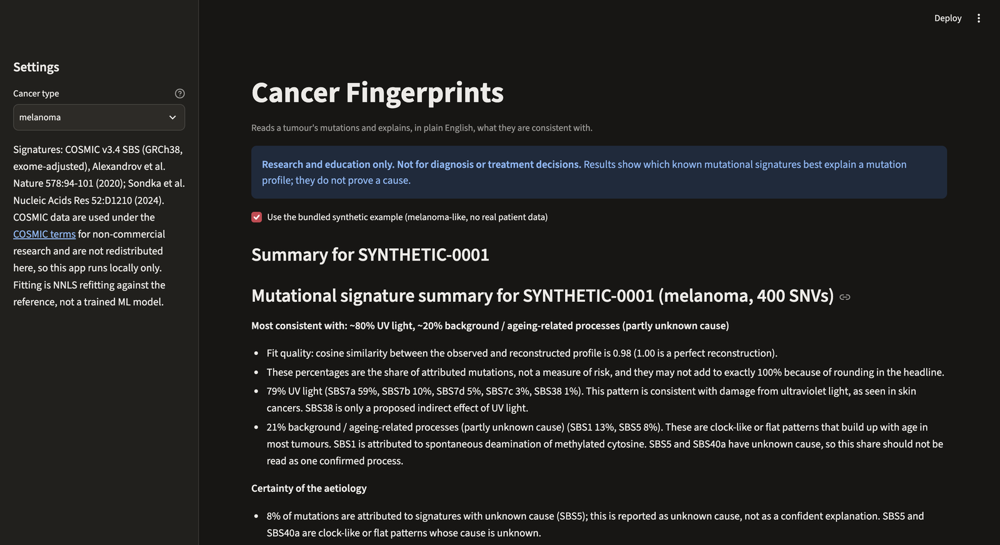
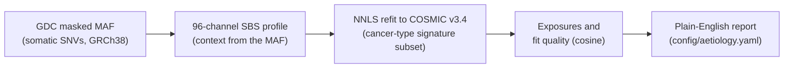
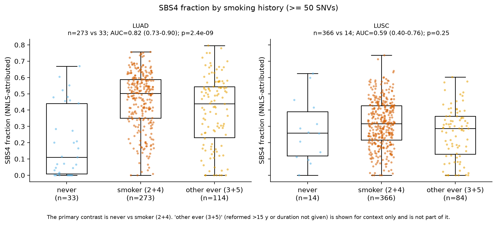
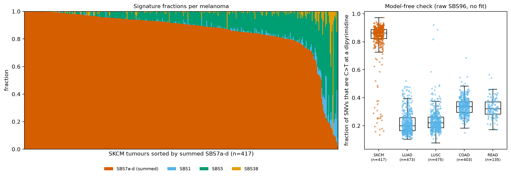
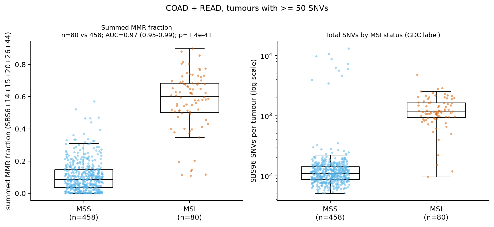
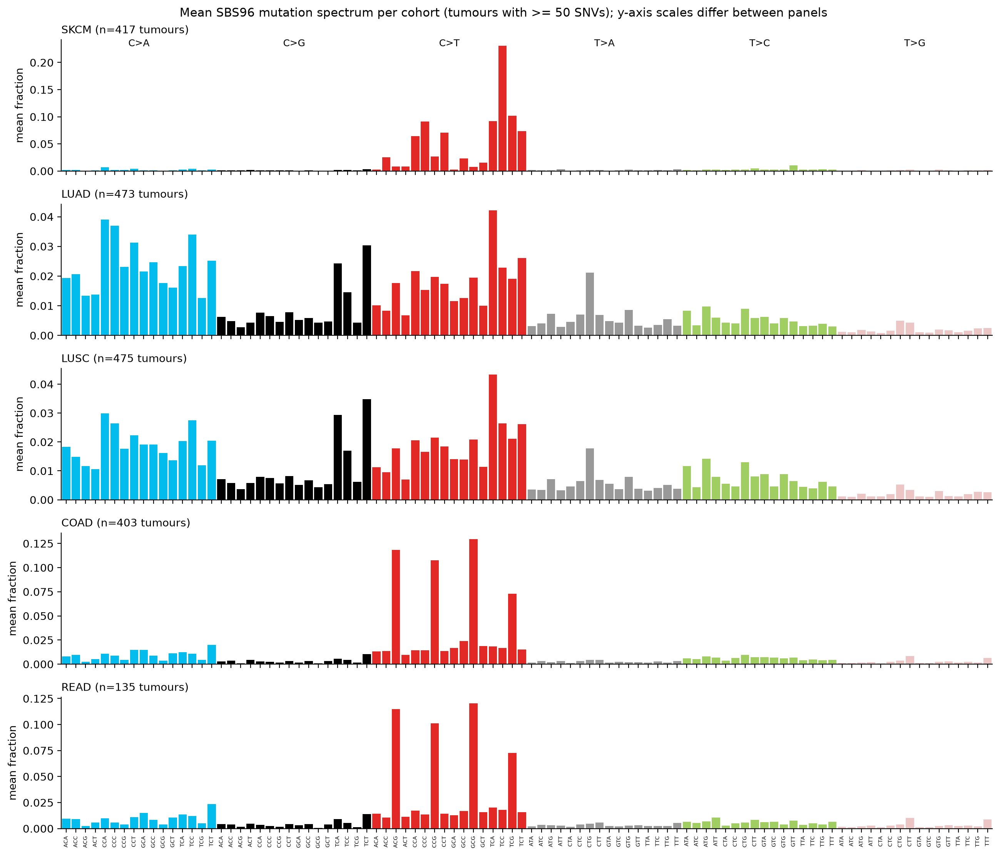
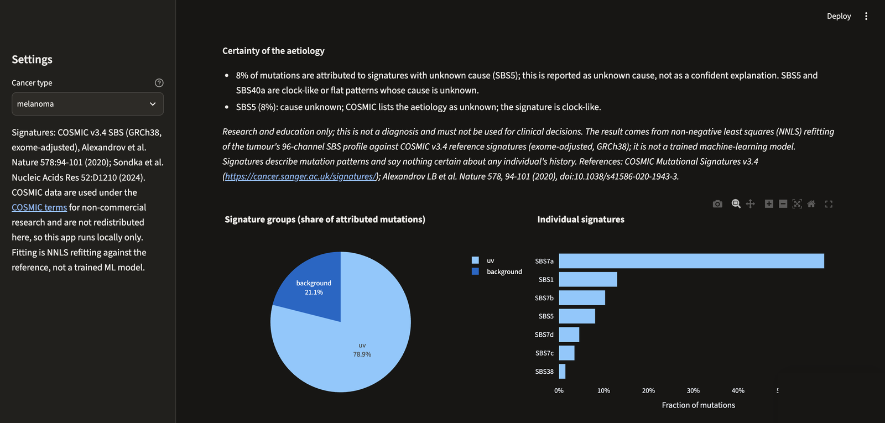
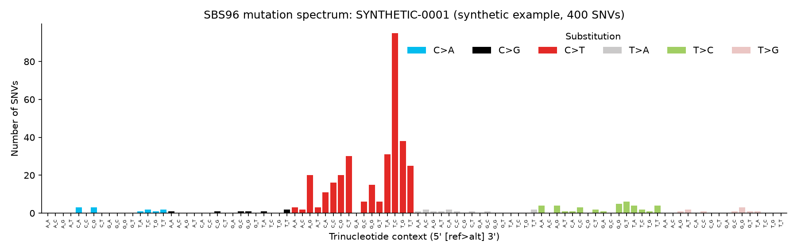

# Cancer Fingerprints

Reads a tumour's somatic mutations and explains, in plain English, what most likely caused them.



*Research and education only. Not for diagnosis or treatment decisions.*

## The crime scene

Different causes of cancer leave different patterns of mutation in DNA, a little like
fingerprints at a crime scene. Tobacco smoke tends to cause C>A changes. Ultraviolet (UV) light
causes C>T changes at dipyrimidines (two pyrimidine bases next to each other). Defects in DNA
mismatch repair (MMR) leave their own scattering of small changes, usually with many more
mutations overall. These recurring patterns are called **mutational signatures**. Each mutation
is classed by the base that changed and the bases either side of it, which gives 96 possible
channels, and a tumour's 96-channel profile can be compared with the published COSMIC reference
signatures to estimate which processes shaped it.

## What it does



1. Takes a tumour's single-nucleotide variants from a MAF file.
2. Builds its 96-channel single-base-substitution (SBS) profile.
3. Refits the profile to COSMIC v3.4 reference signatures by non-negative least squares (NNLS).
4. Reports what fraction of the mutations each likely cause explains, in plain language, with a
   warning when the fit is poor.

This is signature **refitting** to a published reference, not signature discovery and not a
trained machine-learning model.

## Key results

Does the fit recover known biology? Three checks, using TCGA tumours with at least 50 SNVs. The
analyses and settings were fixed before the results were seen
([decisions D7](docs/decisions.md)). The numbers are *consistent with* the expected biology; they do
not prove the cause of any individual tumour. Every number below is in
[results/validation_summary.md](results/validation_summary.md), written by
`scripts/run_validation.py` from the tables in `results/tables/validation_*.tsv`.

### 1. Lung adenocarcinoma: tobacco signature SBS4 is higher in smokers

SBS4 fraction in smokers (current smokers and those reformed for 15 years or less; n=273, median
0.50) vs lifelong never-smokers (n=33, median 0.11): AUC 0.82 (95% CI 0.73-0.90), Mann-Whitney
p=2.4e-9. The result holds at the other SNV thresholds (AUC 0.88 at 20 SNVs, 0.72 at 100; every
lower confidence bound is above 0.5), but the 50-SNV headline was fixed in advance and not chosen
afterwards. Lung squamous cell carcinoma (LUSC) is underpowered, with 14 never-smokers (AUC 0.59,
95% CI 0.40-0.76), and is reported descriptively.



Two things the numbers do not show cleanly:

- **Never-smokers with SBS4.** 11 of 33 LUAD never-smokers (33%, Wilson 95% CI 20-50%) have an SBS4
  fraction above 0.25. Possible reasons include misreported smoking history, second-hand smoke, or
  overlap between SBS4 and similar signatures; this analysis cannot tell these apart. For context,
  whole-genome sequencing of never-smoker lung cancers found no strong tobacco signatures, even with
  second-hand smoke exposure (Zhang et al. 2021).
- **No dose-response in the fraction.** SBS4 fraction does not track pack-years in ever-smokers
  (Spearman rho 0.03, 95% CI -0.08 to 0.14, n=321, in LUAD). A fraction is compositional and
  pack-years are self-reported, so this was not expected to be a sensitive test. SBS4 mutation
  *count* vs pack-years is a secondary test added after the fraction result was seen: rho 0.15
  (95% CI 0.04-0.25, p=0.0075, no multiplicity correction) in LUAD, which may partly reflect
  overall mutation burden.

### 2. Melanoma: UV signatures dominate

Summed SBS7a-d (the UV signatures) accounts for a median 0.91 of mutations (IQR 0.84-0.96; n=417
TCGA-SKCM tumours). It is the single largest component in 395 of 417 tumours (94.7%). A model-free
check on the raw profile agrees: the fraction of SNVs that are C>T at a dipyrimidine has a median of
0.86 in melanoma vs 0.20 in LUAD, with no signature fitting involved (AUC 0.98, 95% CI 0.97-0.99).
Most chosen SKCM samples are metastases (see Method). 22 of 417 tumours have summed SBS7a-d at or
below 0.5; they are flagged in `results/tables/validation_melanoma_non_uv.tsv`, not excluded.



### 3. Colorectal: mismatch-repair signatures in MSI tumours

Summed mismatch-repair signatures (SBS6+14+15+20+26+44) in microsatellite-unstable (MSI) tumours
(n=80, median 0.60) vs microsatellite-stable (MSS) tumours (n=458, median 0.09), colon and rectum
combined: AUC 0.97 (95% CI 0.95-0.99), p=1.4e-41. MSI tumours also carry far more SNVs (median
1,163 vs 110). MSI status is the GDC's bioinformatic call, not a clinical test.



Caveats:

- MSS tumours are not at zero (median 0.09). Low summed MMR exposure in MSS tumours is consistent
  with SBS1/SBS6 similarity and NNLS noise rather than true MMR deficiency. This is inferred from
  the data (for example, SBS1 and SBS6 fractions are negatively correlated in MSS tumours, Spearman
  rho -0.30), not demonstrated.
- MSI was 17.5% of colon cases with a call (75/428) and 5.8% of rectal cases (9/155), as expected,
  since MSI is rarer in rectal cancer. Rectum alone has only 6 MSI tumours at 50+ SNVs, so its
  AUC (0.94, 95% CI 0.82-1.00) is imprecise.
- Seven MSI-labelled tumours have summed MMR below 0.25. They are kept and listed in
  `results/tables/validation_colorectal_msi_low_mmr.tsv`; no explanation is asserted.

### More figures

The mean 96-channel SBS spectrum of each cohort (tumours with at least 50 SNVs). Melanoma is
dominated by C>T at dipyrimidines, lung shows a broad C>A component, and colorectal shows C>T
peaks at CpG contexts.



Signature groups and individual exposures for the synthetic melanoma example:



SBS96 spectrum of the synthetic melanoma example (drawn by `scripts/make_app_spectrum.py`):



## Method

Full decisions, with dates and reasons, are in [docs/decisions.md](docs/decisions.md).

- **Data.** GDC open-access masked somatic mutation files (MAF) from TCGA, GRCh38, whole-exome
  sequencing (WES): LUAD, LUSC, SKCM, COAD and READ. Clinical tables come from the GDC (smoking
  history for lung; MSI status and score for colorectal).
- **One tumour per patient.** Primary tumour (`-01`) if there is one, otherwise metastatic (`-06`),
  with the lowest aliquot barcode breaking ties. Most SKCM samples therefore come from
  metastases (D2).
- **Profiles.** Each SNV's trinucleotide context is read from the MAF `CONTEXT` column, so no
  reference genome is needed. Tri-allelic and multi-allelic positions are dropped. By default,
  adjacent SNVs (likely doublets) are left out of the SBS96 counts. This is our own conservative
  choice (D5), and rerunning melanoma with them counted as SBS changes the median summed SBS7a-d
  by 0.000.
- **Signatures.** COSMIC SBS v3.4, GRCh38, **exome-adjusted** because TCGA is exome data.
  Possible sequencing-artefact signatures (SBS27, SBS43, SBS45-60, SBS95) are excluded.
- **Cancer-type subsets.** Each cohort is fitted to a short list of signatures, taken from
  Alexandrov et al. 2020 and signed off by Prithviraj Dasgupta (D7): lung SBS1, 2, 4, 5, 13, 18;
  melanoma SBS1, 5, 7a-d, 38; colorectal SBS1, 5, 40a, 44, 6, 15, 26, 14, 20, 10a, 10b, 28, 18.
- **Fitting.** Direct unpenalised NNLS (`scipy.optimize.nnls`) on exactly that subset.
  SigProfilerAssignment supplies only the bundled COSMIC reference file.
- **Minimum 50 SNVs.** Tumours with fewer are skipped and counted. Results at 20 and 100 SNVs are
  sensitivity analyses.
- **Fit-quality warning.** Every tumour gets a reconstruction cosine. The report and app warn when
  it is below 0.90. As a separate sensitivity analysis, validation is rerun without tumours below
  0.8; that filter never uses smoking or MSI status.
- **Plain-English text** lives in one reviewable file, [config/aetiology.yaml](config/aetiology.yaml),
  with the COSMIC aetiology cited for each signature and "unknown" or "proposed" stated where that
  is the case.

## Limitations

- **Refitting, not discovery.** Only known COSMIC signatures are fitted. A process that is not in
  the chosen subset is absorbed by whichever fitted signatures resemble it. De novo signature
  extraction is out of scope.
- **Exome only.** Everything here uses whole-exome data. Exome-adjusted signatures are used, but
  no whole-genome data have been used here.
- **Signature bleed.** SBS1, SBS5 and SBS40a are flat, overlapping patterns that can trade exposure
  with each other, as can SBS1 and SBS6, and SBS18 with others. Summaries therefore group them
  ("background / ageing-related processes, partly unknown cause"). The cause of SBS5 and SBS40a is
  unknown.
- **Subsets chosen from published prevalence.** The subsets rest on prevalences read off a figure
  in Alexandrov et al. 2020 (Extended Data Fig. 5), which are approximate, and the paper has no
  TCGA-only breakdown. Signatures outside a subset cannot be reported.
- **Newer signatures not included.** SBS88 (colibactin), SBS36 and SBS10c/d are not fitted for
  colorectal, and APOBEC (SBS2/13) is not fitted for melanoma or colorectal.
- **Labels are ours.** Which aetiologies are labelled "known" or "proposed" is our reading of the
  COSMIC pages. MSI status is a
  GDC bioinformatic call (MSIsensor2, 20% cut-off), not a clinical test.
- **Cohort effects.** The 50-SNV filter ignores smoking status but removes about half of LUAD
  never-smokers (69 chosen, 33 with 50+ SNVs), who also have poorer fits (median cosine 0.84 vs
  0.93 in smokers).
- **Input.** MAF only, with a `CONTEXT` column. VCF input is not supported yet.
- **Not for clinical use.** Signature activity is not a diagnosis, and it does not prove the cause
  of any individual tumour.

## How to run

You need [uv](https://docs.astral.sh/uv/) and Python 3.11+. The GDC download is about 330 MB of
open-access data and needs internet access.

```bash
# 1. install (the extras bring in the COSMIC reference copy and the app)
uv sync --extra signatures --extra app

# 2. download data and the COSMIC v3.4 reference (into gitignored data/)
uv run python scripts/download_data.py
uv run python scripts/download_signatures.py

# 3. choose one tumour per patient and derive smoking / MSI groups
uv run python scripts/select_samples.py

# 4. profile: MAF -> 96-channel SBS matrix per tumour
uv run python scripts/build_profiles.py
uv run python scripts/build_profiles.py --adjacent-snvs count_as_sbs --projects TCGA-SKCM

# 5. fit: NNLS refit to the COSMIC v3.4 subsets
uv run python scripts/run_fits.py
uv run python scripts/run_fits.py --adjacent-snvs count_as_sbs --projects TCGA-SKCM
uv run python scripts/run_fits.py --drop-signature SBS18 --projects TCGA-LUAD TCGA-LUSC TCGA-COAD TCGA-READ

# 6. validate: tables, figures and results/validation_summary.md
uv run python scripts/run_validation.py

# 7. the app (local only)
uv run streamlit run app/streamlit_app.py
```

Steps 2 to 6 are also available as one script: `bash scripts/run_pipeline.sh` (run `uv sync` first).

To profile and fit a single MAF with the command-line tool, use `fingerprints profile` and
`fingerprints fit`. See `uv run fingerprints --help`.

In the app, tick "Use the bundled synthetic example" to try it without any data, or upload a MAF
with a `CONTEXT` column (GDC masked somatic MAFs have one) and choose lung, melanoma or colorectal.
The demo runs locally only: COSMIC's terms do not allow COSMIC data on a free-to-access platform,
so there is no hosted version, and permission would have to be requested from COSMIC first (D1).

Tests and lint:

```bash
uv run ruff check .
uv run ruff format --check .
uv run pytest -m "not network"   # what CI runs
```

## Data and licence

- **TCGA data** are open-access GDC masked somatic mutation files and clinical tables, used under
  the [GDC data access policies](https://gdc.cancer.gov/access-data).
  No raw data are committed; `data/` is gitignored.
- **COSMIC signatures** are used under COSMIC's licence terms. **No COSMIC files are in this
  repository.** `scripts/download_signatures.py` copies the v3.4 file bundled with
  SigProfilerAssignment into `data/`, and its checksum is pinned in `config/`.
- **Synthetic example.** `app/example/synthetic_melanoma.maf` is a simulated melanoma-like tumour
  (400 SNVs sampled from a planted mix of SBS7a/b/d, SBS1 and SBS5, at random positions, fixed
  random seed), made by `scripts/make_example_maf.py`. It contains no real patient data and no COSMIC
  matrices; regenerating it needs the locally downloaded COSMIC file.
- **Code licence.** The code in this repository is released under the [MIT licence](LICENSE)
  (copyright 2026 Prithviraj Dasgupta). The MIT licence covers the code only. It does not cover
  TCGA/GDC data or the COSMIC signatures, which keep their own terms (above).

## Citations

1. Alexandrov L.B. et al. (2020) The repertoire of mutational signatures in human cancer. *Nature*
   578:94-101. doi:10.1038/s41586-020-1943-3.
2. Sondka Z. et al. (2024) COSMIC: a curated database of somatic variants and clinical data for
   cancer. *Nucleic Acids Res* 52(D1):D1210-D1217. doi:10.1093/nar/gkad986.
3. Díaz-Gay M. et al. (2023) Assigning mutational signatures to individual samples and individual
   somatic mutations with SigProfilerAssignment. *Bioinformatics* 39(12):btad756.
   doi:10.1093/bioinformatics/btad756.
4. Saini N., Roberts S.A., Klimczak L.J. et al. (2016) The impact of environmental and endogenous
   damage on somatic mutation load in human skin fibroblasts. *PLoS Genet* 12(10):e1006385.
   doi:10.1371/journal.pgen.1006385 (cited by COSMIC for the UV signatures SBS7c and SBS7d).
5. Zhang T. et al. (2021) Genomic and evolutionary classification of lung cancer in never smokers.
   *Nat Genet* 53(9):1348-1359. doi:10.1038/s41588-021-00920-0 (context for never-smokers with SBS4).
6. The Cancer Genome Atlas Network (2012) Comprehensive molecular characterization of human colon
   and rectal cancer. *Nature* 487:330-337 (expected colon MSI/hypermutated fraction).

## Disclaimer

This project is for research and education only. It is not a medical device and must not be used
for diagnosis or to guide treatment.
